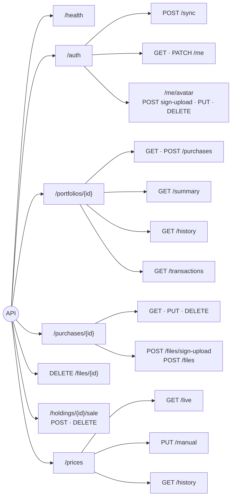
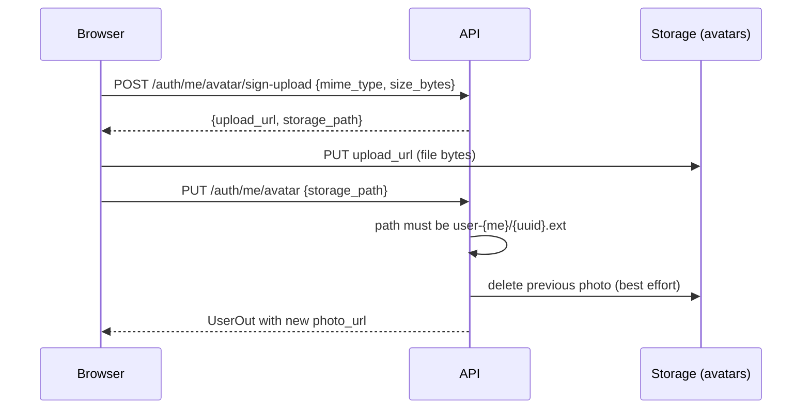
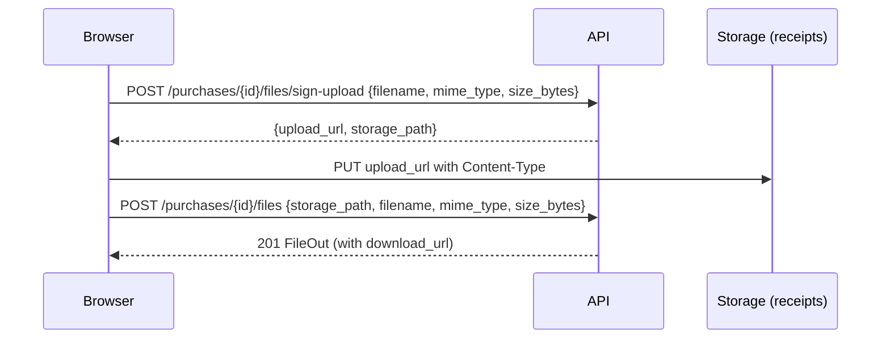

# API reference

> **What this covers:** every endpoint, with its inputs, outputs and errors.
> **Live, clickable version:** run the API and open <http://localhost:8000/docs> (OpenAPI/Swagger; hidden when `ENVIRONMENT=production`).
> **Source of truth:** `app/schemas/*.py` and `app/routers/*.py`. If this page and the code disagree, the code wins. Please fix this page.

---

## 1. Conventions

| Topic | Rule |
|---|---|
| Base URL | `http://localhost:8000` locally (`NEXT_PUBLIC_API_BASE_URL` in the web app) |
| Auth | Every endpoint except `/health` needs `Authorization: Bearer <Supabase access token>` |
| Body | JSON (`Content-Type: application/json`) |
| Money, rates, weights | **Strings** holding decimals, e.g. `"12441.40"`. Send them as numbers or strings; you always get strings back. |
| Dates | `YYYY-MM-DD` (dates) and ISO 8601 with time zone (timestamps) |
| IDs | UUIDs |
| Currencies | `AED`, `USD`, `EUR`, `GBP`, `SAR`, `INR` for profile settings; any 3-letter code on purchases and sales |
| Not yours | Returns **404**, exactly like "doesn't exist" |
| Errors | `{"detail": "message"}`, or for 422 a list of `{"loc": [...], "msg": "..."}` |

### Endpoint map



### All endpoints

| # | Method | Path | Purpose | Success |
|---|---|---|---|---|
| 1 | GET | `/health` | Liveness (no auth) | 200 |
| 2 | POST | `/auth/sync` | Create/refresh profile + portfolio after login | 200 |
| 3 | GET | `/auth/me` | Profile + portfolio | 200 |
| 4 | PATCH | `/auth/me` | Update name / currency / timezone / pricing mode / weight unit | 200 |
| 5 | POST | `/auth/me/avatar/sign-upload` | Signed URL to upload a photo | 200 |
| 6 | PUT | `/auth/me/avatar` | Use the uploaded photo | 200 |
| 7 | DELETE | `/auth/me/avatar` | Remove the photo | 200 |
| 8 | POST | `/portfolios/{portfolio_id}/purchases` | Create a purchase with items | 201 |
| 9 | GET | `/portfolios/{portfolio_id}/purchases` | All purchases (newest first) | 200 |
| 10 | GET | `/purchases/{purchase_id}` | One purchase | 200 |
| 11 | PUT | `/purchases/{purchase_id}` | Replace details + items | 200 |
| 12 | DELETE | `/purchases/{purchase_id}` | Delete with items, sales, receipts | 204 |
| 13 | POST | `/purchases/{purchase_id}/files/sign-upload` | Signed URL to upload a receipt | 200 |
| 14 | POST | `/purchases/{purchase_id}/files` | Register an uploaded receipt | 201 |
| 15 | DELETE | `/files/{file_id}` | Delete a receipt | 204 |
| 16 | POST | `/holdings/{holding_id}/sale` | Sell a whole item | 201 |
| 17 | DELETE | `/holdings/{holding_id}/sale` | Undo the sale | 204 |
| 18 | GET | `/portfolios/{portfolio_id}/summary` | Value, P/L, rates, per-item values | 200 |
| 19 | GET | `/portfolios/{portfolio_id}/history` | Daily value vs invested | 200 |
| 20 | GET | `/portfolios/{portfolio_id}/transactions` | Purchases + sales feed | 200 |
| 21 | GET | `/prices/live` | Latest GoldAPI rows | 200 |
| 22 | PUT | `/prices/manual` | Save manual rates | 200 |
| 23 | GET | `/prices/history` | Daily pure rate for charts | 200 |

---

## 2. Health

### `GET /health`
No auth. → `{"status": "ok", "service": "mintfolio-api", "version": "0.1.0"}`

---

## 3. Auth and profile (`app/routers/auth.py`)

### `POST /auth/sync`
Ensures a `users` row and a `portfolios` row exist for the token's user. Call it after every login; repeating it is harmless.

| Body field | Type | Notes |
|---|---|---|
| `display_name` | string ≤ 200, optional | Fills the name **only if empty** |
| `avatar_url` | string ≤ 2000, optional | External photo (Google). Fills only if empty. |

The user id and email always come from the **token**, never the body. The email is updated if it changed in Supabase.
**Returns** `MeResponse`. **Errors:** 400 if the token has no email.

### `GET /auth/me`
**Returns** `MeResponse`:

```json
{
  "user": {
    "id": "6f1c…", "email": "layla@example.com", "display_name": "Layla Rahman",
    "avatar_url": null, "photo_url": "https://…/storage/v1/object/sign/avatars/…",
    "preferred_currency": "AED", "timezone": "Asia/Dubai",
    "default_pricing_mode": "live", "weight_unit": "g",
    "manual_gold_rate_per_gram": null, "manual_silver_rate_per_gram": null,
    "manual_rates_currency": null,
    "created_at": "2026-10-17T09:12:00Z", "updated_at": "2026-10-17T09:12:00Z"
  },
  "portfolio": { "id": "a2b9…", "name": "My Portfolio", "created_at": "…", "updated_at": "…" }
}
```

`photo_url` is a signed link to the uploaded photo, valid for 1 h and re-signed on each read. Show it first, then `avatar_url`, then initials.
**Errors:** 404 `User not synced` → call `/auth/sync`.

### `PATCH /auth/me`
Only the fields you send change.

| Field | Allowed values |
|---|---|
| `display_name` | string ≤ 200; blank → cleared |
| `preferred_currency` | `AED` `USD` `EUR` `GBP` `SAR` `INR` |
| `timezone` | any IANA zone, e.g. `Asia/Dubai` (validated) |
| `default_pricing_mode` | `live` · `manual` |
| `weight_unit` | `g` · `oz` · `tola` (display only) |

Sending `null` for anything except `display_name` → 422.
**Returns** `UserOut`.

### Profile photo: 3 steps



| Endpoint | Body | Rules |
|---|---|---|
| `POST /auth/me/avatar/sign-upload` | `mime_type`: `image/jpeg` · `image/png` · `image/webp`; `size_bytes` ≤ 2 MB | Returns `{upload_url, storage_path}`. The URL is valid 10 min. |
| `PUT /auth/me/avatar` | `storage_path` | 400 if the path isn't this user's avatar pattern |
| `DELETE /auth/me/avatar` | — | Deletes the file, clears `avatar_path`. 502 if storage fails. |

---

## 4. Purchases (`app/routers/purchases.py`)

### `POST /portfolios/{portfolio_id}/purchases`

```json
{
  "purchase_date": "2026-03-10",
  "dealer": "Emirates Gold",
  "purchase_currency": "AED",
  "payment_method": "card",
  "card_premium_percentage": "2.50",
  "notes": "Gold Souk visit",
  "items": [
    {
      "metal": "gold", "purity": "24K", "form": "bar",
      "weight_value": "1", "weight_unit": "oz", "quantity": 1,
      "brand": "PAMP Suisse", "purchase_price": "12900.00",
      "spot_rate_at_purchase": null, "premium_paid": null,
      "storage_location": "Home safe", "comments": null
    }
  ]
}
```

| Field | Rules |
|---|---|
| `purchase_date` | required date |
| `dealer`, `notes` | optional, ≤ 200 / ≤ 2000 chars |
| `purchase_currency` | 3 letters; applies to **all** items |
| `payment_method` | `cash` (default) · `card` |
| `card_premium_percentage` | **required for card, must be null for cash**, 0–100 |
| `items` | at least 1 |
| `items[].metal` | `gold` · `silver` |
| `items[].purity` | free text ≤ 20 (`24K`, `22K`, `999`, `916`, `925`…). Blank = pure. |
| `items[].form` | `coin` `bar` `bullion` `jewelry` `round` `other`, or null |
| `items[].weight_value` + `weight_unit` | > 0; `g` · `kg` · `oz` (troy). The server computes `weight_grams`; the client can't send it. |
| `items[].quantity` | ≥ 1 (default 1) |
| `items[].purchase_price` | ≥ 0, this item's share of the order total |
| `items[].spot_rate_at_purchase` | optional, per gram **of the item** |
| `items[].premium_paid`, `brand`, `storage_location`, `comments` | optional |

**Returns** `201 PurchaseOut`:

| Field | Notes |
|---|---|
| purchase fields above + `id`, `portfolio_id`, `created_at`, `updated_at` | |
| `items[]` | `HoldingOut`: the item fields + `id`, `weight_grams`, `status` (`active`/`sold`), `sale` (or null), timestamps. **In entry order.** |
| `total_amount` | sum of item prices (computed, not stored) |
| `files[]` | `FileOut`: `id`, `filename`, `mime_type`, `size_bytes`, `storage_path`, `uploaded_at`, `download_url` (signed, 5 min) |

### `GET /portfolios/{portfolio_id}/purchases`
→ `{"purchases": [PurchaseOut, …]}`, newest purchase date first, with signed receipt links.

### `GET /purchases/{purchase_id}`
→ `PurchaseOut`.

### `PUT /purchases/{purchase_id}`
Same body as create, but each item may carry an `id`:

| Item in body | Effect |
|---|---|
| has `id` of an existing item | that item is updated |
| no `id` | a new item is added |
| existing item not in the list | removed (**409** if it's sold) |

**Errors:** 400 for unknown or duplicate item ids · 409 when removing a sold item.

### `DELETE /purchases/{purchase_id}`
Deletes the receipt files from storage first, then the purchase. Items, sales and file rows cascade. **204.** 502 if storage fails (nothing is deleted).

---

## 5. Receipts (`app/routers/files.py`)



| Endpoint | Body / rules | Returns |
|---|---|---|
| `POST /purchases/{id}/files/sign-upload` | `filename` ≤ 200, `mime_type` `image/jpeg` · `image/png` · `application/pdf`, `size_bytes` ≤ 5 MB | `{upload_url, storage_path}` (valid 10 min) |
| `POST /purchases/{id}/files` | same fields + `storage_path`. The path must be `user-{me}/purchase-{id}/{uuid32}.{jpg\|png\|pdf}`, else 400. | `201 FileOut` |
| `DELETE /files/{file_id}` | — | `204`; 502 if storage fails (row kept) |

---

## 6. Sales (`app/routers/sales.py`)

### `POST /holdings/{holding_id}/sale`

```json
{ "sale_price": "5900.00", "sale_currency": "AED", "sale_date": "2026-10-17",
  "sold_to": "Gold Souk", "fees": "50.00", "spot_rate_at_sale": null, "comments": null }
```

Sells the **whole** item and marks it `sold`. Returns **201** with the item (`HoldingOut`, including `sale`).
**Errors:** 409 if already sold · 422 if `sale_date` is before the purchase date.
Realized P/L (`sale_price − purchase_price − fees`) is computed in the summary and feed, and only when the sale and purchase currencies match.

### `DELETE /holdings/{holding_id}/sale`
Removes the sale and sets the item back to `active`. **204.** 404 if there's no sale.

---

## 7. Portfolio analytics (`app/routers/portfolios.py`, `transactions.py`)

### `GET /portfolios/{portfolio_id}/summary`
Everything Home, Holdings and the purchase page need, in the user's **preferred currency**.

| Field | Meaning |
|---|---|
| `currency`, `pricing_mode` | `AED`, `live`/`manual` |
| `rates[]` | the rate used for valuation per metal: `metal`, `rate_per_gram` (pure), `currency`, `source` (`goldapi`/`metalsdev`/`manual`), `fetched_at` |
| `market_rates[]` | latest market pure rate per metal + `previous_day`, `previous_rate`, `change_pct` (for the rate cards) |
| `total_value` | current value of valued active items |
| `cost_basis` | price paid for those items |
| `total_invested` | price paid for all items (active + sold) |
| `unrealized_pl`, `unrealized_pl_pct` | `total_value − cost_basis` |
| `realized_pl` | sum over sold items (same-currency sales) |
| `all_time_pl`, `all_time_pl_pct` | unrealized + realized, % on (cost basis + cost of sold) |
| `today_change` | `{day, previous_day, amount, pct}`; **null in manual mode** or with < 2 price days |
| `active_count`, `sold_count` | items in this currency |
| `unvalued_count` | active items that couldn't be priced |
| `other_currency_count` | items bought in another currency (left out of totals) |
| `by_metal[]` | per metal: `grams`, `pure_grams`, `current_value`, `cost_basis` |
| `holdings[]` | per item: `current_value`, `unrealized_pl`, `realized_pl`, and premium fields `melt_value_at_purchase`, `premium`, `premium_pct`, `premium_source` (`entered`/`market`) |

All formulas: [pricing-and-valuation.md](pricing-and-valuation.md).

### `GET /portfolios/{portfolio_id}/history?range=ALL`
`range`: `1M` `3M` `6M` `YTD` `1Y` `5Y` `ALL` (default `ALL`).
→ `{currency, range, points: [{day, value, invested, realized}]}`. There is one point per day, from the first purchase (or the range start) **to today**. It is always valued at **market** rates, even in manual mode.

### `GET /portfolios/{portfolio_id}/transactions?type=all&since=&limit=100`

| Query | Values |
|---|---|
| `type` | `all` · `purchase` · `sale` |
| `since` | date; keeps rows on or after it |
| `limit` | 1–500 (default 100) |

→ `{"transactions": [TransactionOut]}`, newest first:

| Field | Purchase row | Sale row |
|---|---|---|
| `kind` | `purchase` | `sale` |
| `date` | purchase date | sale date |
| `purchase_id` | the order | the order the item came from |
| `holding_id` | null | the sold item |
| `title` | dealer (or "Unknown dealer") | item label, e.g. "Gold 22K coin" |
| `detail` | "Gold 24K bar + 1 more" | buyer |
| `amount`, `currency` | order total | sale price |
| `realized_pl` | null | sale − cost − fees (same currency only) |
| `item_count`, `receipt_count`, `payment_method` | filled | 1, 0, null |
| `item_labels[]`, `metals[]` | every item | the one item |

---

## 8. Prices (`app/routers/prices.py`)

### `GET /prices/live`
Latest **GoldAPI** row for every stored metal, purity and currency (all karats). Reads the stored rows and never calls GoldAPI.
→ `{"prices": [{metal, purity, currency, rate_per_gram, source, fetched_at}]}`

### `PUT /prices/manual`
```json
{ "currency": "AED", "gold_rate_per_gram": "395.50", "silver_rate_per_gram": "4.20" }
```
Rates are for **pure** metal (24K / 999); at least one is required. Saves them on the profile and appends `manual` rows to `price_history`. To actually use them, also `PATCH /auth/me {"default_pricing_mode": "manual"}`.
→ `UserOut`.

### `GET /prices/history?metal=gold&range=1Y&currency=AED`

| Query | Values |
|---|---|
| `metal` | `gold` · `silver` (required) |
| `range` | `1M` `3M` `6M` `YTD` `1Y` `5Y` `ALL` (default `1Y`) |
| `currency` | optional; defaults to the user's preferred currency |

→ `{metal, purity: "24K"|"999", currency, range, points: [{day, rate_per_gram}], sources: ["goldapi","metalsdev"]}`. There is one pure rate per day; GoldAPI wins when both sources have that day, and missing days are carried forward. **Only AED has data today.**
