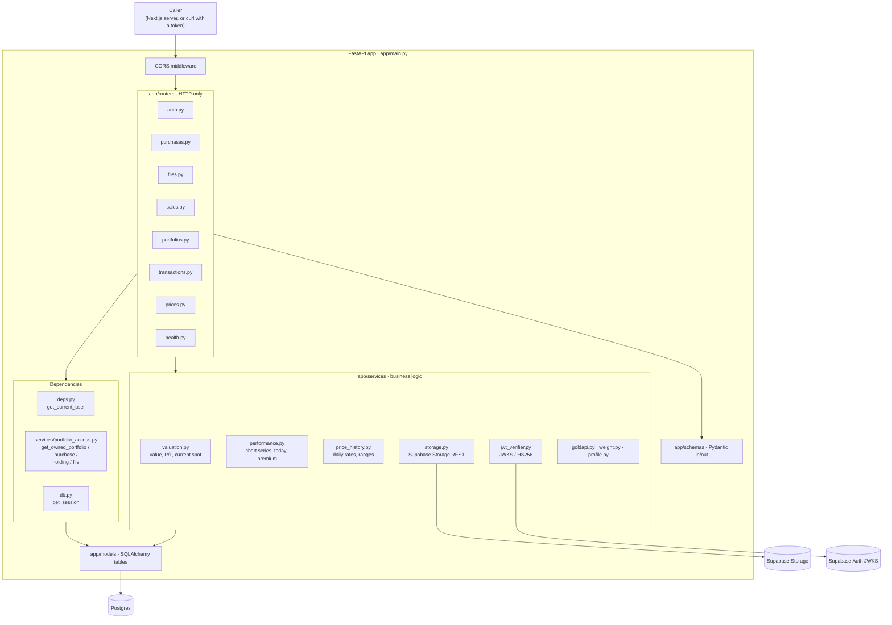
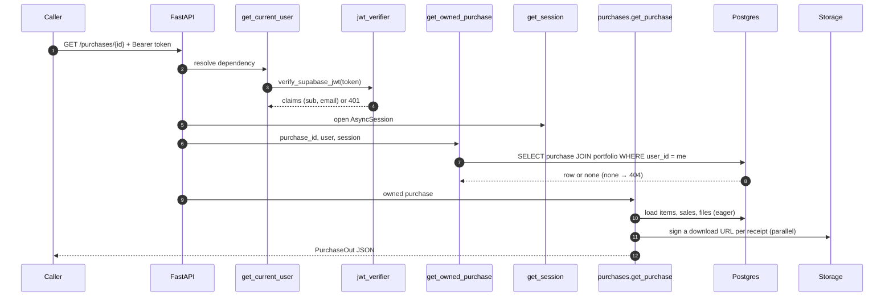
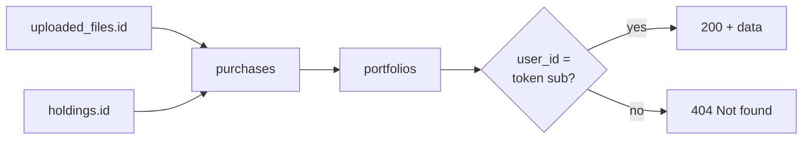
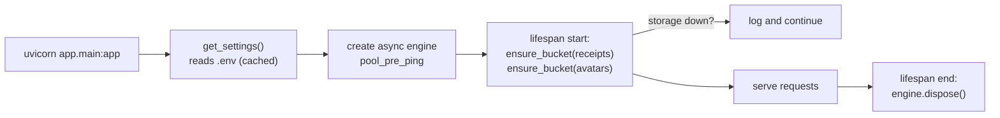

# API architecture (low level)

> **What this covers:** how `mintfolio-api` is organised inside, how a request travels through it, and the patterns every endpoint follows.
> **Big picture first?** Read the project-wide [Architecture](https://github.com/aa055/mintfolio-docs/blob/main/docs/02-architecture.md). (Project-wide docs live in the [mintfolio-docs](https://github.com/aa055/mintfolio-docs) repo.)

---

## 1. Layers



| Layer | Folder | Rule |
|---|---|---|
| **Routers** | `app/routers/` | Parse input, call dependencies and services, shape output. No maths here. |
| **Dependencies** | `app/deps.py`, `app/services/portfolio_access.py`, `app/db.py` | Who is calling, do they own the resource, and a DB session. |
| **Services** | `app/services/` | All business logic. `valuation`, `performance` and `price_history` are **pure functions over plain data** where possible, so they're unit-testable without a database. |
| **Schemas** | `app/schemas/` | The public contract (request and response). Mirrored by hand in `mintfolio-web/lib/api-types.ts`. |
| **Models** | `app/models/` | Tables, constraints, indexes. Changed only together with an Alembic migration. |
| **Jobs** | `app/jobs/` | Command-line scripts (`python -m app.jobs.…`) that share models and services. |

---

## 2. Folder map

```
mintfolio-api/
├── app/
│   ├── main.py              create_app(): CORS, routers, lifespan (creates buckets, disposes engine)
│   ├── config.py            Settings from .env (pydantic-settings), cached by get_settings()
│   ├── db.py                async engine + SessionLocal + get_session dependency
│   ├── deps.py              get_current_user → CurrentUser(id, email) from the Bearer JWT
│   ├── models/              users, portfolios, purchases, holdings, sales, price_history, uploaded_files
│   ├── schemas/             user.py, purchase.py, file.py, price.py, transaction.py
│   ├── routers/             one file per area (see API reference)
│   ├── services/
│   │   ├── jwt_verifier.py      token verification + JWKS cache (1 h, refetch on unknown kid)
│   │   ├── portfolio_access.py  ownership-scoped lookups → 404 if not yours
│   │   ├── valuation.py         purity parsing, item value, summary totals, latest spot rule
│   │   ├── price_history.py     daily pure rates, gap filling, chart ranges, USD pegs
│   │   ├── performance.py       value-vs-invested series, today's change, premium over spot
│   │   ├── storage.py           buckets, signed upload/download URLs, deletes
│   │   ├── goldapi.py           GoldAPI client (jobs only)
│   │   ├── weight.py            g / kg / troy oz → grams
│   │   └── profile.py           UserOut with a fresh signed photo URL
│   └── jobs/
│       ├── fetch_prices.py      daily GoldAPI → price_history
│       └── backfill_prices.py   metals.dev 5-year history (one-off, idempotent)
├── alembic/versions/        4 migrations (see database.md)
├── tests/                   unit tests (maths) + health
├── .github/workflows/       daily-prices.yml
└── docs/                    you are here
```

---

## 3. Life of a request

Example: `GET /purchases/{purchase_id}`.



FastAPI resolves the dependencies in order. A router only runs once the caller has been **authenticated** (valid token) and **authorised** (owns the resource).

---

## 4. Patterns used everywhere

### 4.1 Ownership = 404, not 403

`portfolio_access.py` provides `OwnedPortfolioDep`, `OwnedPurchaseDep`, `OwnedHoldingDep` and `OwnedFileDep`. Each one joins down to `portfolios.user_id = current user`. A resource that exists but belongs to someone else looks exactly like one that doesn't exist.



### 4.2 Relationships are `lazy="raise"`

Every ORM relationship raises an error if it is touched without being loaded. Routers load what they need up front with `selectinload` or `joinedload` (for example `_FULL_PURCHASE` in `purchases.py`). This makes hidden N+1 queries impossible, which matters because each query is a full round trip to a remote database.

### 4.3 Money is `Decimal`, rounded per item

- DB columns: `numeric(14,2)` for money, `numeric(14,4)` for rates and weights.
- Python: `Decimal` end to end.
- JSON: Pydantic serialises `Decimal` as a **string**.
- Values are rounded to the cent **per item** before summing, in both `valuation.value_holding` and `performance._lot_value`. That makes the Home tile and the chart's last point equal to the cent.

### 4.4 Writes are atomic

- **Create purchase:** the purchase plus all its items go in one transaction. Any bad item rolls back the lot.
- **Update purchase** is a full replacement. Items with an `id` are updated, items without one are added, and missing ones are removed. Removing a sold item → **409**.
- **`/auth/sync`** is idempotent. It creates the user and portfolio if missing, and only fills an *empty* name or photo.

### 4.5 Storage first, then database

When deleting a receipt, a purchase or an avatar, the API removes the **storage object first**. If storage fails, it returns **502** and keeps the DB row, so the user can retry. The reverse order would leave orphaned files that nothing points to.

### 4.6 The server builds storage paths

The client never chooses a path:

| Bucket | Path pattern |
|---|---|
| `receipts` | `user-{user_id}/purchase-{purchase_id}/{uuid32}.{jpg\|png\|pdf}` |
| `avatars` | `user-{user_id}/{uuid32}.{jpg\|png\|webp}` |

When registering a file, the API checks the path matches that exact pattern for **this** user and purchase.

### 4.7 External calls never sit on the request path for prices

Only the jobs call GoldAPI and metals.dev. Request handlers read `price_history`.

---

## 5. Startup and configuration



- `ENVIRONMENT=production` hides `/docs`.
- Bucket creation is idempotent and sets the MIME whitelist and size limit **on the bucket itself**, so storage enforces them too.
- The full variable list is in [development.md](development.md#2-configuration).

---

## 6. Error handling

| Status | When | Example `detail` |
|---|---|---|
| 400 | Bad input that passed schema checks | `storage_path is not under this purchase's prefix` |
| 401 | Missing, bad or expired token | `Invalid or expired token: …` |
| 404 | Not found **or not yours**; user not synced | `Purchase not found` · `User not synced. Call POST /auth/sync first.` |
| 409 | State conflict | `This item is already sold…` · `A sold item can't be removed. Undo its sale first.` |
| 422 | Schema validation (FastAPI/Pydantic), sale before purchase | list of `{loc, msg}` |
| 502 | Supabase Storage failed | `Storage error: …` |

The web app turns these into readable messages in `apiErrorMessage()` (`mintfolio-web/lib/api-client.ts`).

---

## 7. Adding a new endpoint (checklist)

1. **Schema:** add request/response models in `app/schemas/`. Use `Decimal` and `Literal` enums.
2. **Ownership:** take `OwnedPortfolioDep` (or the purchase/holding/file variant). Never trust IDs from the body.
3. **Logic:** put calculations in a service as pure functions, and add a unit test in `tests/`.
4. **Router:** load relationships explicitly (`selectinload`). Keep queries few, because each is a round trip.
5. **Register** the router in `app/main.py` if it's a new file.
6. **Check:** `ruff check .`, `pytest`, then try it at `/docs`.
7. **Web:** mirror the types in `mintfolio-web/lib/api-types.ts`.
8. **Docs:** add it to [api-reference.md](api-reference.md).
