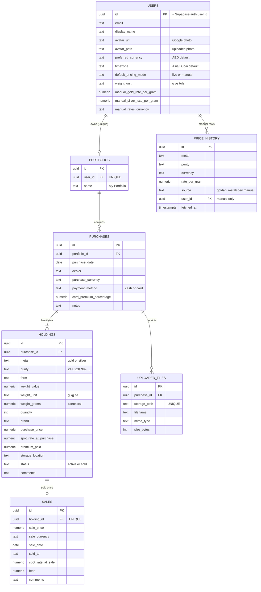
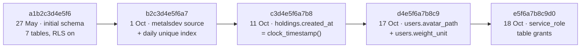

# Database

> **What this covers:** the **current** schema (7 tables), every constraint and index, storage buckets, and the migration history.
> **Source of truth:** `app/models/*.py` and `alembic/versions/`. The current head is `e5f6a7b8c9d0`.
> The original design reasoning (revision 2, May 2026) is kept in [schema-design.md](schema-design.md).

---

## 1. Entity-relationship diagram



All foreign keys are `ON DELETE CASCADE`. Deleting a user removes everything below it.

---

## 2. Conventions

| Concern | Choice |
|---|---|
| Primary keys | `uuid`, `gen_random_uuid()` (except `users.id`, which is the Supabase user id) |
| Timestamps | `timestamptz`, UTC. `created_at` + `updated_at` on mutable tables. |
| Money | `numeric(14,2)` |
| Per-gram rates | `numeric(14,4)` |
| Weights | `numeric(12,4)`; `weight_grams` is the canonical value |
| Enums | `text` + `CHECK` (adding a value = a small migration, no enum type) |
| Deletes | hard delete with cascade |
| RLS | **enabled on every table, no policies** (deny by default). The API connects as the DB owner. |
| Grants | `anon` / `authenticated` have **no** read/write privileges on public tables, so they're locked out twice. `service_role` has them (migration `e5f6a7b8c9d0`). |

---

## 3. Tables

### 3.1 `users`
The app-side profile. Created by `POST /auth/sync`; `id` equals `auth.users.id`, but there's no cross-schema foreign key.

| Column | Type | Rules |
|---|---|---|
| `id` | uuid | PK |
| `email` | text | NOT NULL; follows Supabase on every sync |
| `display_name` | text | nullable |
| `avatar_url` | text | external photo (Google) |
| `avatar_path` | text | object path in `avatars` bucket; shown before `avatar_url` |
| `preferred_currency` | text | NOT NULL, default `AED`, CHECK in AED/USD/EUR/GBP/SAR/INR |
| `timezone` | text | NOT NULL, default `Asia/Dubai` |
| `default_pricing_mode` | text | NOT NULL, default `live`, CHECK live/manual |
| `weight_unit` | text | NOT NULL, default `g`, CHECK g/oz/tola (display only) |
| `manual_gold_rate_per_gram` / `manual_silver_rate_per_gram` | numeric(14,4) | pure-metal rates for manual mode |
| `manual_rates_currency` | text | currency of the manual rates |
| `created_at`, `updated_at` | timestamptz | |

### 3.2 `portfolios`
| Column | Type | Rules |
|---|---|---|
| `id` | uuid | PK |
| `user_id` | uuid | FK → users, **UNIQUE** (`uq_portfolios_user_id`): one per user in the MVP |
| `name` | text | default `My Portfolio` |

### 3.3 `purchases`
One dealer order.

| Column | Type | Rules |
|---|---|---|
| `portfolio_id` | uuid | FK → portfolios |
| `purchase_date` | date | NOT NULL |
| `dealer` | text | |
| `purchase_currency` | text | NOT NULL; applies to all items |
| `payment_method` | text | default `cash`, CHECK cash/card |
| `card_premium_percentage` | numeric(5,2) | 0–100; **NULL for cash, NOT NULL for card** (`ck_purchases_card_premium_method_match`) |
| `notes` | text | |

Index: `ix_purchases_portfolio_id_purchase_date (portfolio_id, purchase_date)`.
The purchase total is **not stored**. It's the sum of its items' `purchase_price`.

### 3.4 `holdings`
One line item.

| Column | Type | Rules |
|---|---|---|
| `purchase_id` | uuid | FK → purchases |
| `metal` | text | CHECK gold/silver |
| `purity` | text | free text, nullable (null = pure) |
| `form` | text | CHECK coin/bar/bullion/jewelry/round/other or NULL |
| `weight_value` | numeric(12,4) | > 0, as typed |
| `weight_unit` | text | CHECK g/kg/oz |
| `weight_grams` | numeric(12,4) | > 0, computed by the API |
| `quantity` | int | ≥ 1, default 1 |
| `brand` | text | |
| `purchase_price` | numeric(14,2) | ≥ 0, in the purchase currency |
| `spot_rate_at_purchase` | numeric(14,4) | optional, per gram of the item |
| `premium_paid` | numeric(14,2) | optional, ≥ 0 |
| `storage_location`, `comments` | text | |
| `status` | text | CHECK active/sold, default active |
| `created_at` | timestamptz | default **`clock_timestamp()`**, so items keep entry order |

Indexes: `ix_holdings_purchase_id`, `ix_holdings_metal_status (metal, status)`.

### 3.5 `sales`
| Column | Type | Rules |
|---|---|---|
| `holding_id` | uuid | FK → holdings, **UNIQUE** (no partial sales) |
| `sale_price` | numeric(14,2) | ≥ 0 |
| `sale_currency` | text | NOT NULL |
| `sale_date` | date | NOT NULL; the API requires ≥ purchase date |
| `sold_to` | text | |
| `spot_rate_at_sale` | numeric(14,4) | optional |
| `fees` | numeric(14,2) | ≥ 0, default 0 |
| `comments` | text | |

### 3.6 `uploaded_files`
| Column | Type | Rules |
|---|---|---|
| `purchase_id` | uuid | FK → purchases |
| `storage_path` | text | **UNIQUE**, `user-{uid}/purchase-{pid}/{uuid}.{ext}` |
| `filename` | text | the original name, for display |
| `mime_type` | text | CHECK image/jpeg, image/png, application/pdf |
| `size_bytes` | int | 1 … 5,242,880 (5 MB) |
| `uploaded_at` | timestamptz | |

Index: `ix_uploaded_files_purchase_id`.

### 3.7 `price_history`
Append-only price snapshots. No `updated_at`.

| Column | Type | Rules |
|---|---|---|
| `metal` | text | CHECK gold/silver |
| `purity` | text | `24K`…`10K` for gold, `999` for silver |
| `currency` | text | |
| `rate_per_gram` | numeric(14,4) | ≥ 0 |
| `source` | text | CHECK `goldapi` · `metalsdev` · `manual` |
| `user_id` | uuid | **NULL for market sources, NOT NULL for manual** (`ck_price_history_source_user_match`) |
| `fetched_at` | timestamptz | the provider's timestamp; decides the "price day" |

| Index | Columns | Purpose |
|---|---|---|
| `ix_price_history_lookup` | metal, purity, source, fetched_at | latest-rate lookups |
| **`uq_price_history_market_daily`** (unique, partial `WHERE source <> 'manual'`) | metal, purity, currency, source, `(fetched_at AT TIME ZONE 'UTC')::date` | **one market row per day**: jobs can re-run safely |
| `ix_price_history_manual_user_lookup` (partial `WHERE source = 'manual'`) | user_id, metal, purity, fetched_at | a user's manual history |

---

## 4. Storage buckets (Supabase Storage)

| Bucket | Public? | Allowed types | Max size | Path | Link lifetime |
|---|---|---|---|---|---|
| `receipts` | private | jpg, png, pdf | 5 MB | `user-{uid}/purchase-{pid}/{uuid}.{ext}` | upload 10 min · view 5 min |
| `avatars` | private | jpg, png, webp | 2 MB | `user-{uid}/{uuid}.{ext}` | upload 10 min · view 1 h |

The API creates both buckets at startup if they're missing (`ensure_bucket`), with the type and size limits set **on the bucket**.

---

## 5. Migration history



| Revision | Date | Change |
|---|---|---|
| `a1b2c3d4e5f6` | 27 May 2026 | Initial 7 tables, checks, indexes, RLS enabled |
| `b2c3d4e5f6a7` | 1 Oct 2026 | `price_history.source` allows `metalsdev`; partial unique index per market source and day |
| `c3d4e5f6a7b8` | 11 Oct 2026 | `holdings.created_at` default → `clock_timestamp()` |
| `d4e5f6a7b8c9` | 17 Oct 2026 | `users.avatar_path`, `users.weight_unit` (CHECK g/oz/tola) |
| `e5f6a7b8c9d0` | 18 Oct 2026 | `service_role` gets SELECT/INSERT/UPDATE/DELETE on all current and future tables. This is for projects created with "expose new tables" off; it's a no-op on older ones. |

**Commands**

```bash
alembic upgrade head                              # apply
alembic revision --autogenerate -m "describe it"  # create (always read the file it makes)
alembic downgrade -1                              # undo one
alembic current                                   # where am I
```

Autogenerate misses some things: partial indexes, expression indexes and `server_default` functions. Hand-edit those, as the existing migrations do.

---

## 6. Useful queries

```sql
-- Price coverage per source and currency
select source, currency, count(*),
       min((fetched_at at time zone 'UTC')::date) as first_day,
       max((fetched_at at time zone 'UTC')::date) as last_day
from price_history group by 1, 2 order by 1, 2;

-- A user's items with their purchase
select p.purchase_date, p.dealer, h.metal, h.purity, h.weight_grams, h.quantity, h.purchase_price, h.status
from holdings h
join purchases p on p.id = h.purchase_id
join portfolios pf on pf.id = p.portfolio_id
where pf.user_id = '<user uuid>'
order by p.purchase_date desc, h.created_at;
```
