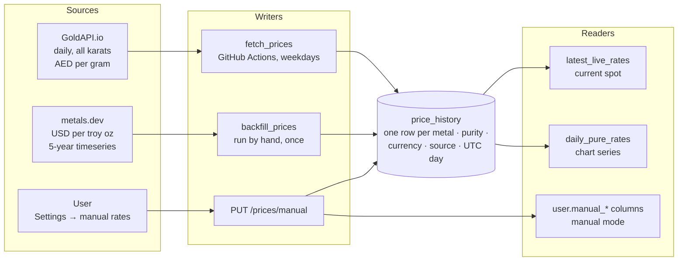

# Pricing and valuation

> **What this covers:** where prices come from, how they're stored, and every formula behind the numbers on screen: value, P/L, today's change, the chart, and premium over spot.
> **Code:** `app/services/valuation.py`, `price_history.py`, `performance.py`, `app/jobs/*`. Tests: `tests/test_valuation.py`, `test_price_history.py`, `test_performance.py`.
> Terms are defined in the [Glossary](https://github.com/aa055/mintfolio-docs/blob/main/docs/glossary.md).

---

## 1. Price data pipeline



| Source | Writer | What it stores | Coverage today |
|---|---|---|---|
| `goldapi` | `python -m app.jobs.fetch_prices` (GitHub Actions, Mon–Fri) | Gold 24K, 22K, 21K, 20K, 18K, 16K, 14K, 10K and silver 999, per gram, for each currency in `PRICE_CURRENCIES` (default `AED`) | AED from 28 Sep 2026 |
| `metalsdev` | `python -m app.jobs.backfill_prices` (once) | **Pure only** (24K / 999). USD/oz is converted to per gram, then to AED/SAR via the USD peg. | AED, 30 Sep 2021 → 15 Oct 2026 |
| `manual` | `PUT /prices/manual` | A user's own pure rates (history only; valuation reads the profile columns) | per user |

### 1.1 Daily job (`fetch_prices`)
1. For each currency and metal, it skips the pair if a GoldAPI row was already **created today (UTC)**. `--force` overrides this.
2. It calls `GET https://www.goldapi.io/api/XAU/AED` (or `XAG`), which costs one call.
3. It deletes any GoldAPI rows for that **price day**, then inserts one row per purity. It commits per pair, so one failure doesn't lose the other.
4. It exits with status 1 if any pair failed, which makes the GitHub run go red.

**Quota:** 2 calls per weekday per currency ≈ 44/month (free tier is 100).

### 1.2 Backfill (`backfill_prices`)
- metals.dev `timeseries` gives **30 days per call**, weekends included. Five years is about 61 calls; the real run used 63.
- It only fetches windows with missing days. Inserts use `ON CONFLICT DO NOTHING` on the daily unique index, so re-running is safe.
- Holes **inside** the stored range are treated as provider gaps and skipped. metals.dev has none for 10–11 Dec 2024 or 25 Dec 2024 – 1 Jan 2025. `--fill-gaps` retries them.
- It refuses to run if the plan needs more than `--max-calls`. `--dry-run` shows the plan with no API calls.
- Only USD-pegged currencies are stored: `USD` ×1, `AED` ×3.6725, `SAR` ×3.75. Others need historical FX (Phase 2).

---

## 2. Reading prices: two rules

### Rule 1: one rate per day (charts, premium, today's change)
`price_history.daily_pure_rates(_many)`:
- Reads only the **pure** purity (24K / 999).
- Takes one row per UTC day. If both sources have that day, **GoldAPI wins**; otherwise the latest row that day.
- **Carries the last rate forward** over missing days (weekends, skipped runs). It never extends past the last real day.
- Several metals and currencies come back in **one query** (each query is a full round trip).

### Rule 2: current spot (valuation)
`valuation.latest_live_rates` returns the pure rate per (metal, currency) from the **latest market day**, GoldAPI preferred. That's the same rule as the charts, so rate cards, tiles and the chart's last point always agree.

In **manual mode**, `rates_for_user` returns the user's own rates from their profile instead.

### Chart ranges
`1M` = 30 days · `3M` = 91 · `6M` = 182 · `1Y` = 365 · `5Y` = 1826 · `YTD` = since 1 Jan · `ALL` = everything.

---

## 3. Purity → fraction of pure metal

Every value starts from the **pure** rate and scales it by purity. This works for any purity text, not just the karats GoldAPI lists.

| Purity text | Read as | Fraction |
|---|---|---|
| *(blank)* | pure | 1 |
| `24K`, `22K`, `18kt` | karats ÷ 24 | 1 · 0.9167 · 0.75 |
| `22` | bare karat (≤ 24) | 0.9167 |
| `0.999` | already a fraction | 0.999 |
| `99.9` / `99.9%` | percent (≤ 100) | 0.999 |
| `999`, `916`, `925`, `999.9` | parts per thousand | 0.999 · 0.916 · 0.925 · 0.9999 |
| `9999` | four nines | 0.9999 |
| `abc`, `30K`, `0` | not understood | **None → item is "unvalued"** |

---

## 4. The formulas

### 4.1 One item (`value_holding`)

```
current_value  = pure_rate × purity_fraction × weight_grams × quantity      (rounded to cents)
unrealized_pl  = current_value − purchase_price
realized_pl    = sale_price − purchase_price − fees                         (sold items, same currency only)
```

An active item is **unvalued** if there's no rate for its (metal, purchase currency) or its purity can't be read.

### 4.2 Portfolio summary (`summarize`)

Only items bought in the **preferred currency** count. The others add to `other_currency_count`.

| Total | Formula |
|---|---|
| `total_value` | Σ current_value of valued active items |
| `cost_basis` | Σ purchase_price of valued active items |
| `total_invested` | Σ purchase_price of **all** items (active + sold) |
| `unrealized_pl` | total_value − cost_basis |
| `unrealized_pl_pct` | unrealized_pl ÷ cost_basis × 100 |
| `realized_pl` | Σ realized_pl of sold items |
| `all_time_pl` | unrealized_pl + realized_pl |
| `all_time_pl_pct` | all_time_pl ÷ (cost_basis + cost of sold items with a P/L) × 100 |
| `by_metal[].pure_grams` | Σ weight_grams × quantity × fraction |

### 4.3 Today's change (`day_change`)
It compares the **last two price days** (not calendar days), for items held on both days:

```
amount = Σ [ value at latest day − value at previous day ]
pct    = amount ÷ Σ value at previous day × 100
```

Items bought on the latest day are left out, because they have no "before". This is hidden in manual mode.

### 4.4 Performance chart (`portfolio_series`)
For each day from the first purchase (or the range start) **to today**:

```
value(day)    = Σ item value at that day's rate, for items held that day
invested(day) = Σ purchase_price of items held that day
realized(day) = Σ realized P/L of sales on or before that day
```

- An item counts **from its purchase date until the day before its sale**.
- The latest price is carried forward to today, so a purchase or sale made today shows up at once. The last point equals the summary's `total_value`.
- Items in other currencies, or with unreadable purity, are left out of **both** lines, so the gap between them is always a real gain or loss.
- The chart always uses market rates, even in manual mode.

### 4.5 Premium over spot (`purchase_premium`)

```
if the user entered spot_rate_at_purchase:            source = "entered"
    melt_value = spot_rate_at_purchase × weight_grams × quantity
else:                                                 source = "market"
    melt_value = pure rate on the purchase date × purity_fraction × weight_grams × quantity

premium      = purchase_price − melt_value           (negative = paid below spot)
premium_pct  = premium ÷ melt_value × 100
```

The user's spot rate is per gram **of the item**, matching the purchase form's maths check. The premium is null when neither rate exists, for example a purchase in a currency without history.

---

## 5. Worked example

The rates below are made up, to keep the arithmetic easy.

**Rates:** gold 24K spot = **AED 400.00 /g** today and **AED 396.00 /g** on the previous price day. On the purchase date (10 Mar 2026) it was **AED 380.00 /g**.

**Purchase (AED, card 2.5%), from Emirates Gold:**

| Item | Weight | Qty | Paid |
|---|---|---|---|
| Gold 24K bar | 1 oz = 31.1035 g | 1 | 12,900.00 |
| Gold 22K coin | 8 g | 2 | 5,600.00 |

**Current value**

| Item | Calculation | Value |
|---|---|---|
| Bar | 400 × 1 × 31.1035 × 1 | **12,441.40** |
| Coin | 400 × 22/24 × 8 × 2 = 366.667 × 16 | **5,866.67** |
| **Total** | | **18,308.07** |

**P/L:** cost basis 18,500.00 → unrealized **−191.93** (−1.04%).

**Today:** previous-day values are 396 × 31.1035 = 12,316.99 and 396 × 22/24 × 16 = 5,808.00, a total of 18,124.99.
→ today's change = 18,308.07 − 18,124.99 = **+183.08** (+1.01%).

**Premium over spot (bar, market source):** melt = 380 × 31.1035 = 11,819.33 → premium = 12,900 − 11,819.33 = **1,080.67** (9.14%).

**Sell the coins** for 5,900 with 50 fees → realized = 5,900 − 5,600 − 50 = **+250.00**.
After the sale: value 12,441.40, cost basis 12,900, unrealized −458.60, realized +250.00, all-time **−208.60**. The all-time % is −208.60 ÷ (12,900 + 5,600) = −1.13%. Total invested stays 18,500.

---

## 6. Edge cases

| Case | Behaviour |
|---|---|
| No price for the user's currency (e.g. USD today) | Items are unvalued; rate cards and history are empty. |
| Weekend / missed job | The previous price is carried forward; "Today" compares the last two **price** days. |
| Job ran after midnight UTC | Its prices belong to the new UTC day, and that day's scheduled run then skips. |
| Manual mode | Valuation uses profile rates; `today_change` is null; the chart still uses market rates. |
| Sale in a different currency from the purchase | The sale is recorded, but realized P/L is null and not totalled. |
| Purity like `916` | Valued as 0.916 of the pure rate (not as GoldAPI's 22K). |
